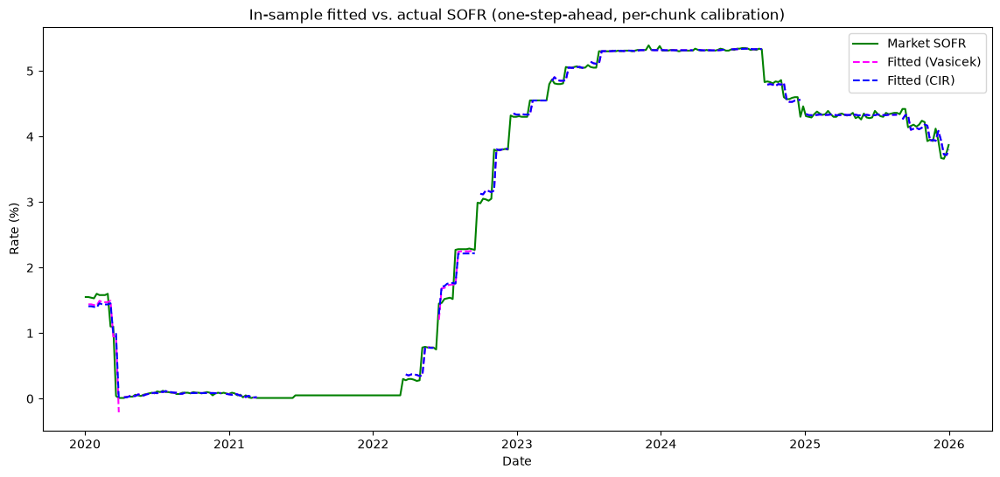
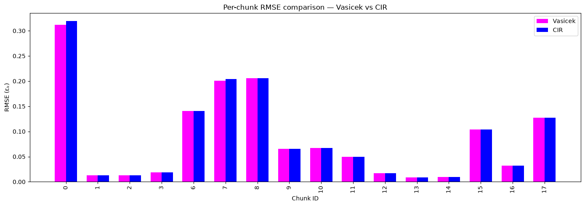
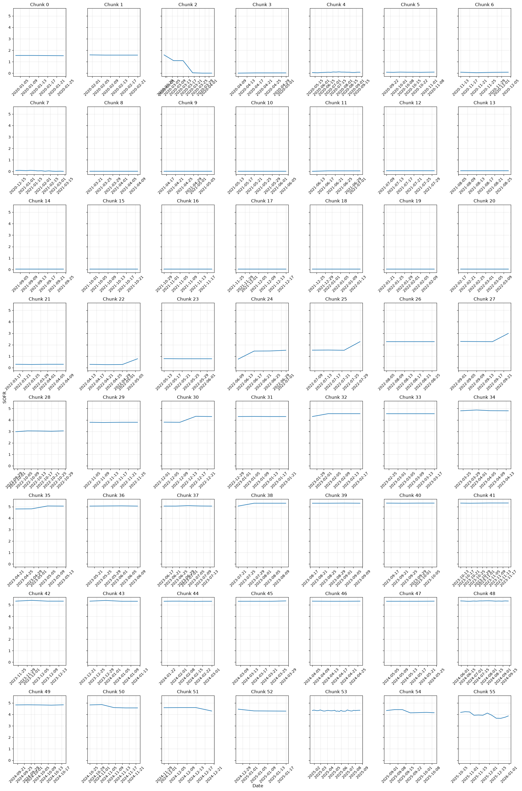
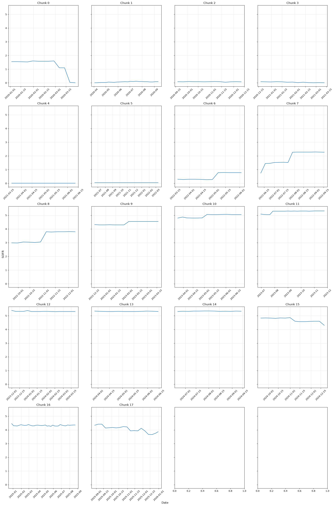

# SOFR Short-Rate Modelling: Vasicek vs CIR with a Partitioning Approach

A Python replication of **Orlando, Mininni & Bufalo**, [*Forecasting interest rates through Vasicek and CIR models: a partitioning approach*](https://arxiv.org/abs/1901.02246) (Journal of Forecasting, 2020), applied to the **US Secured Overnight Financing Rate (SOFR)**, 2020–2025.

A single set of parameters for the whole history can't capture regime changes like the 2020 cut to zero, the 2022–23 hiking cycle or the 2024–25 easing. So the series is **split into statistically homogeneous chunks**, Vasicek and CIR are **calibrated separately on each chunk**, and the two models are compared on in-sample one-step-ahead fit.



---

## Results (normality partitioning)

| Model | Overall weighted RMSE ε<sub>e</sub> |
|---|---|
| **Vasicek** | **0.1122** |
| CIR | 0.1136 |

- 314 weekly observations → 36 Lilliefors chunks → **18 chunks** after merging to a minimum size of 12.
- 2 chunks from the zero-rate period (Mar 2021 – Mar 2022) are excluded from calibration because there is no variance to estimate from.
- Under normality-based partitioning, **Vasicek fits slightly better than CIR** on SOFR. The paper's headline comparison (on EUR rates) uses non-central χ² partitioning, which is still in progress here ([Roadmap](#roadmap)).

<p align="center">
  
</p>

---

## Methodology

### 1. Data
Daily overnight SOFR from FRED (`SOFR`), downloaded with `pandas-datareader`. It is sampled to **weekly** frequency (Δt = 1 week) by taking the **last available trading day of each ISO week**, which handles holiday weeks without forward-filling.

### 2. Partitioning by normality
Forward-expanding windows: starting from 4 points, the window grows one observation at a time for as long as the **Lilliefors test** fails to reject normality (α = 0.05). When the test rejects, the chunk closes and the next one starts.

- **ZIRP guard:** windows with standard deviation below 0.01 count as passing. During 2020–22 SOFR is almost constant, so the test statistic is undefined, and without the guard that period breaks into dozens of tiny chunks (56 chunks vs 36).
- **Merge step:** small chunks are chained forward until every group has at least **12 points**, which keeps the estimators stable.

| No guard (56 chunks) | Guard + merge (18 chunks) |
|---|---|
|  |  |

### 3. Calibration
Each chunk is calibrated with the closed-form **estimating-function estimators of Bibby et al.** (paper eqs. 5–6):

| Model | Dynamics |
|---|---|
| Vasicek | dr = κ(θ − r)dt + σ dW |
| CIR | dr = κ(θ − r)dt + σ√r dW |

### 4. In-sample fit and error analysis
The one-step-ahead fitted value conditions on the **actual previous observation**:

r̂<sub>t</sub> = θ + (r<sub>t−1</sub> − θ) e<sup>−κΔt</sup>

Fit is measured by per-chunk RMSE ε<sub>k</sub> and the size-weighted overall RMSE (paper eq. 9):

ε<sub>e</sub> = √( Σ<sub>k</sub> (n<sub>k</sub>/n) ε<sub>k</sub>² )

---

## Repository structure

```
.
├── SOFR_Term_Structure.ipynb   # full analysis: data → partitioning → calibration → fit → errors
├── figures/                    # plots used in this README
├── requirements.txt
├── LICENSE
└── README.md
```

## Getting started

```bash
git clone https://github.com/<your-username>/<repo-name>.git
cd <repo-name>

python -m venv .venv
source .venv/bin/activate        # Windows: .venv\Scripts\activate
pip install -r requirements.txt

jupyter notebook SOFR_Term_Structure.ipynb
```

SOFR data comes straight from FRED, so no API key or data files are needed. The notebook uses a fixed window (2020-01-01 to 2026-01-01), so reruns give the same results unless FRED revises the series.

---

## Roadmap

- [x] Weekly SOFR pipeline from FRED
- [x] Lilliefors partitioning with ZIRP guard and minimum-size merge
- [x] Per-chunk Vasicek and CIR calibration (Bibby estimators)
- [x] In-sample fit and weighted RMSE comparison
- [ ] **Non-central χ² partitioning:** constrain the `ncx2` fit (`floc=0, fscale=1`). With all four parameters free, the fit passes the KS test on any window and the whole sample collapses into one chunk.
- [ ] Vasicek vs CIR comparison under χ² partitioning (the paper's main test)
- [ ] Out-of-sample forecasting with rolling windows

## References

- Orlando, G., Mininni, R. M., & Bufalo, M. (2020). Forecasting interest rates through Vasicek and CIR models: A partitioning approach. *Journal of Forecasting*, 39(4), 569–579. [arXiv:1901.02246](https://arxiv.org/abs/1901.02246)
- Bibby, B. M., Jacobsen, M., & Sørensen, M. (2010). Estimating functions for discretely sampled diffusion-type models. *Handbook of Financial Econometrics*.
- Federal Reserve Bank of St. Louis, FRED series [SOFR](https://fred.stlouisfed.org/series/SOFR).

## Author

**Nikhil Srivastava**, MS Financial Mathematics, NC State University

## License

[MIT](LICENSE)
